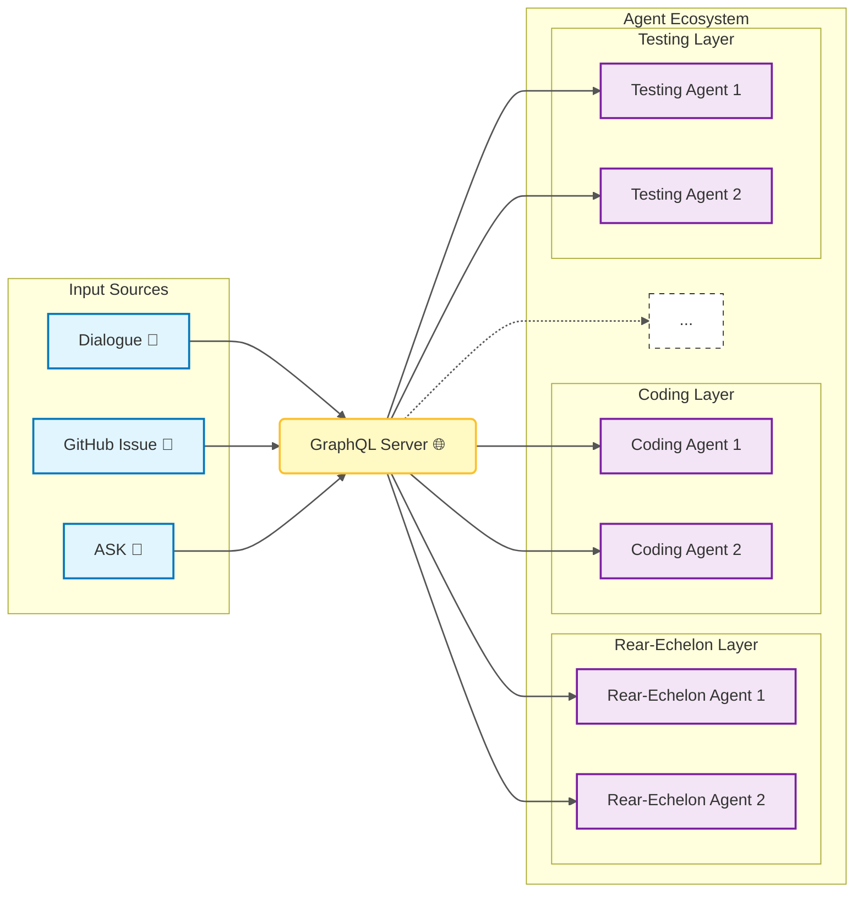

# 以GraphlQL-Relay 为基础的多智能体系统系统 

> 利用GraphQL-Relay 为基础，构建一个多智能体系统，每个智能体都有自己的任务和职责，通过GraphQL-Relay 进行通信和协调。

> ref: ./external/   里的对话文件
总体框架草图如下 

## 技术要点

### 用户接口-GraphQL服务器端
用户输入，或者其他来源信息， 结构化为GraphQL-数据格式。
### 后台任务端
1. 把 工作的Agent 看做 React 程序中的一个组件，每个组件都有自己的任务和职责。
2. Agent 分为几个大的基础类型，根据Rear-Echelon、Coding、Testing 等层级，每个层级都有自己的Agent 类型,分别配置默认的skill和behavior。然后根据即时服务器查询结果，确定具体任务和状态
3. 每个组件通过GraphQL-Relay 进行通信和协调。
4. 每个组件都有自己的状态和行为，通过GraphQL-Relay 进行更新和查询。
5. 同一个由提示触发，多个组件可以同时工作，每个组件可以尝试不同的解决方法
6. 作为传统路由的Agent 也是一个或者多个组件，他们不直接与其他工作Agent 通信，而是通过GraphQL-Relay 进行协调。  
7. 整体可扩展，可以根据需要添加新的组件或Agent。例如添加数据清洗Agent组件，或者数据可视化Agent组件。同类组件可以并行工作，展示弱的社区
8. 整体可监控，可以根据需要监控每个组件的状态和行为。
### 分组和任务派发策略
1. Rear-Echelon ：根据用户请求， 工具链， 上下文，确定任务分工， 特殊工具配置， 上下文分割后，编码为GraphQL-数据格式。发送到GraphQL 服务器端。
2. Coding ：根据任务分工， 调用对应的Agent 组件， 执行任务。
3. Testing ：根据任务分工， 调用对应的Agent 组件， 执行任务。
4. MoreAgents ：根据需要添加新的组件或Agent。
##  指令 

按照上面的要求， 构建一个最小化的系统。   第一步先创建一个对话框，  要求我输入一个提示，你可以设定下来框， 实现多个任务同时执行。 一个简单的的前端任务即可
